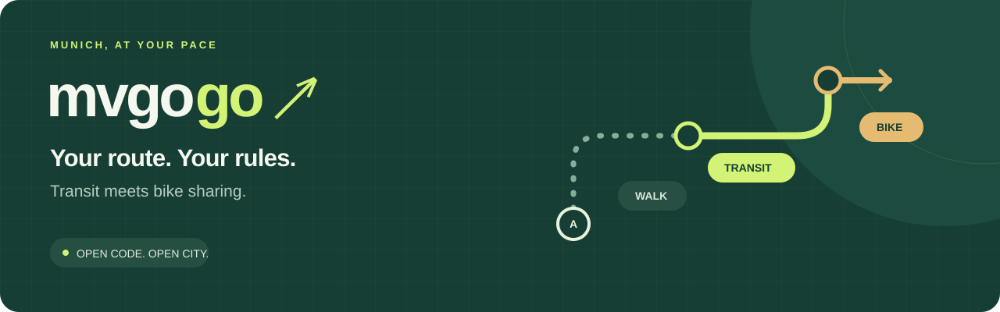
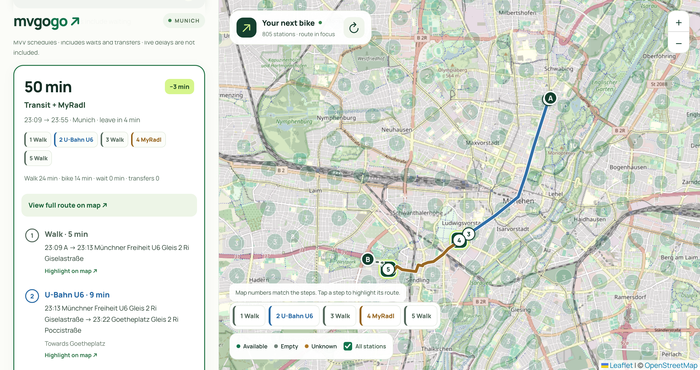
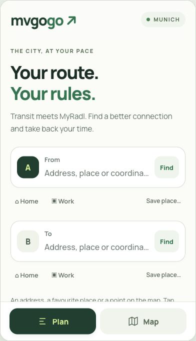
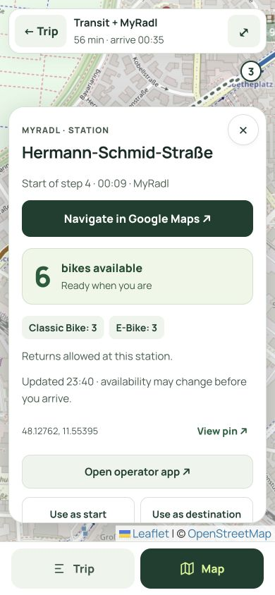
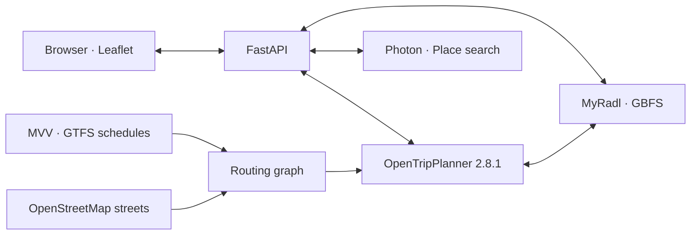

<div align="center">



# A better connection through Munich.

**Compare public transport with MyRadl bike sharing.**<br>
Find the station, understand the transfer, and see what a different route could save.

[](https://github.com/erikotoz/mvgogo/actions/workflows/checks.yml)
[](LICENSE)
[](pyproject.toml)
[](#project-status)

[Get started](#get-started) · [Screenshots](#see-it-in-action) · [How it works](#how-it-works) · [Roadmap](#roadmap) · [Contribute](CONTRIBUTING.md)

</div>

## One trip. More ways to get there.

Sometimes the best connection is a bus ride followed by a bike, instead of another
transfer. mvgogo explores those options using Munich's public transport schedules,
OpenStreetMap streets and current MyRadl station availability.

Search for a place, pick a departure time, and compare transit, cycling and mixed
routes in one map. No account or API key is required for local use.

## See it in action



<p align="center"><em>Münchner Freiheit → Westpark: numbered legs connect the itinerary to the map.</em></p>

| Plan your trip | Explore a station |
| :---: | :---: |
|  |  |

Screenshots show actual application output captured on 21 October 2026. Routes,
station counts and availability are examples from that session and will change.
Map imagery: © [OpenStreetMap contributors](https://www.openstreetmap.org/copyright).

## Built for the whole connection

| Feature | What you get |
| --- | --- |
| **Transit + bike comparison** | Transit-only, bike-only and rental before or after transit, ranked by arrival time. |
| **Transfers you can understand** | Scheduled boarding times, walking between services and waiting shown separately. |
| **Current station availability** | Bike counts, vehicle types, return status and source timestamps from public GBFS. |
| **A map that stays readable** | Station clusters while browsing; background stations fade when a route or station is selected. |
| **Places, not just coordinates** | Address and landmark search, map selection and browser-local Home/Work shortcuts. |
| **A phone-friendly layout** | Dedicated Plan and Map views, readable station cards and numbered route steps. |
| **Honest fallback behaviour** | Cached station locations remain visible during outages; stale availability becomes unknown. |

## Get started

**Just want to explore stations?** Install [uv](https://docs.astral.sh/uv/getting-started/installation/)
and run:

```sh
git clone https://github.com/erikotoz/mvgogo.git
cd mvgogo
make install
make dev
```

Open **[localhost:8000](http://localhost:8000)**. The map and station availability
work independently of the routing engine.

**Want route comparisons too?** Install Java 21+ and prepare the routing graph:

```sh
make prepare
make graph
```

Then keep the routing engine running in another terminal:

```sh
make router
```

Leave `make dev` running and choose **Try an example → Find a route** in the app.
The first preparation downloads roughly 320 MB; graph building defaults to an
8 GB Java heap and needs additional system memory. Allow about a minute after
starting OTP for its first station update.

See [Getting started](docs/getting-started.md) for Docker Compose, configuration,
data refreshes and troubleshooting.

## How it works



Python, FastAPI and httpx serve the API. Plain JavaScript, Leaflet and a locally
hosted Manrope font power the interface. OpenTripPlanner combines GTFS, OSM and
GBFS for routing. Python dependencies are locked; the OTP download is pinned and
verified with SHA-256. No frontend build step or database is required.

The app compares four search scenarios, removes duplicates, checks rental stations
and filters results against walking/cycling limits. Transfer waits follow the
schedule. A two-minute transfer allowance, 90-second pickup allowance and
45-second return allowance are configured inside the routing engine.

[Architecture and search behaviour →](docs/architecture.md)

## Hosting

A useful starting point for personal use is **2–4 vCPU · 8 GB RAM · 20 GB SSD**,
with Linux and no GPU. Graph building needs roughly **12–16 GB RAM** and can run on
a separate computer; upload the finished graph to the server afterwards.

A local smoke test used about **2.36 GiB RSS** for OTP after initial queries. Five
warmed route comparisons took **0.44–0.61 seconds** each on a powerful laptop.
These are observations, not VPS capacity or latency guarantees.

The repository includes Docker Compose and a [native Ubuntu deployment guide](docs/deployment.md).
Public hosting also needs HTTPS, request limits and suitable map tile/geocoding
providers. Use the deployment guide to run your own instance.

[Deployment notes and measurements →](docs/hosting.md)

## Project status

**Working prototype, focused on Munich and nearby suburbs.** The following limits
matter when reading a result:

- **Scheduled transit only.** Live delays and cancellations are not connected.
- **Bikes before or after transit.** A bike ride between two transit journeys is
  not supported yet.
- **Availability is a snapshot.** A bike may be taken before you arrive. Check,
  reserve and pay in the operator's app.
- **Search is bounded.** Results are not an exhaustive search or a guarantee of
  the globally fastest route. Walking/cycling limits filter returned candidates.
- **Browser app today.** Mobile layouts have been checked in browser viewports;
  physical Android/iOS testing, PWA installation and offline routing are pending.

## Roadmap

- [x] Public GBFS stations, availability and outage fallback
- [x] Transit / bike / mixed route comparison
- [x] Scheduled transfer breakdown and interactive route legs
- [x] Address search, Home/Work places and mobile views
- [ ] HTTPS deployment and testing on Android
- [ ] Installable PWA with application icons
- [ ] Benchmark typical trips and concurrent requests on a VPS
- [ ] Explore transit → bike → transit routing
- [ ] Evaluate a reliable source of live transit updates

## Develop and contribute

```sh
make install
make test check
```

Tests cover feed freshness, station outages, geocoding, scheduled transfers,
initial waiting, rental rules and route normalization. They run without live
services or a routing graph. See [CONTRIBUTING.md](CONTRIBUTING.md) for the workflow
and what to include in a routing report.

| Documentation | Contents |
| --- | --- |
| [Getting started](docs/getting-started.md) | Local setup, Docker, configuration, updates and troubleshooting |
| [Architecture](docs/architecture.md) | Data flow, routing scenarios, timing and interface behaviour |
| [Data sources](docs/data-sources.md) | Feed endpoints, coverage, attribution and service terms |
| [Hosting](docs/hosting.md) | Server sizing, measurements and deployment requirements |
| [Ubuntu deployment](docs/deployment.md) | systemd services, nginx, HTTPS and a constrained personal-use profile |
| [Screenshot examples](docs/screenshots.md) | Capture details and reproducible public example points |

## License and credits

Original project code and documentation are licensed under **[MIT](LICENSE)**,
© 2026 erikotoz. Third-party software and data retain their own licenses; see
[Third-party notices](THIRD_PARTY_NOTICES.md).

Powered by [OpenTripPlanner](https://www.opentripplanner.org/),
[Leaflet](https://leafletjs.com/), [Photon](https://github.com/komoot/photon),
[OpenStreetMap](https://www.openstreetmap.org/copyright),
[MVV](https://www.mvv-muenchen.de/en/service-support/mvv-content-for-developers/)
and the public MyRadl / nextbike GBFS feed.

mvgogo is an independent project, unaffiliated with MVG, MVV, MyRadl or nextbike.
