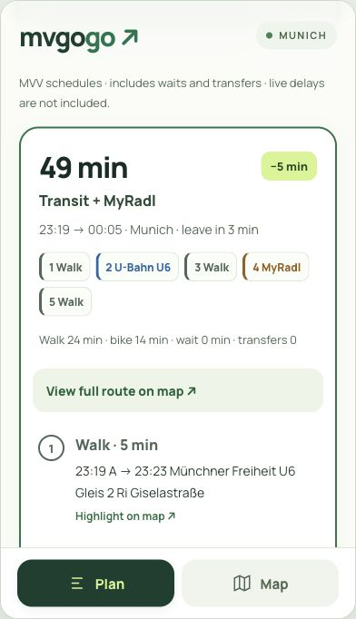

# Screenshot examples

These images were captured from the running application on **21 October 2026**,
using live MyRadl station data and the locally built OTP/MVV graph. No routes or
bike counts were invented for the screenshots. Availability and schedules are
historical examples and must not be used as current travel information.

## Desktop route comparison

- Start: **Münchner Freiheit**, `48.1618, 11.5869`.
- Destination: **Westpark**, `48.1230, 11.5210`.
- Walking limit: 30 minutes; cycling limit: 30 minutes.
- The selected result combines walking, U6 and MyRadl. The arrival comparison
  includes initial waiting; numbered legs match the map.
- Captured with Firefox's page screenshot tool; browser chrome and unrelated tabs
  are excluded. Map attribution is preserved.

To try it, start the web app and OTP, select **Try an example**, then **Find a route**.
Results vary with departure time and availability. The screenshot is not a promise
of the same itinerary or time saving on another trip.

## Mobile views

| Planner | Station details |
| :---: | :---: |
|  |  |

The interface was captured in a **390 × 680 CSS px** browser frame. This exercises
responsive layout, not physical device hardware. The station example shows
Oettingenstraße, with conventional/electric bike counts, return permission, source
time and operator link.

For updated screenshots, use only public points. Capture the current interface
with the map fully loaded, preserve map attribution, and remove any personal saved
places. Include the capture date and viewport size when replacing these examples.
## Mobile route results

The example shows the selected itinerary after calculation and the first numbered
step. Use **View full route on map** to switch views without losing the trip.

The original SVG banner is maintained in [assets/banner.svg](assets/banner.svg).

Map imagery: © [OpenStreetMap contributors](https://www.openstreetmap.org/copyright).
Software and data notices are in [THIRD_PARTY_NOTICES.md](../THIRD_PARTY_NOTICES.md).
